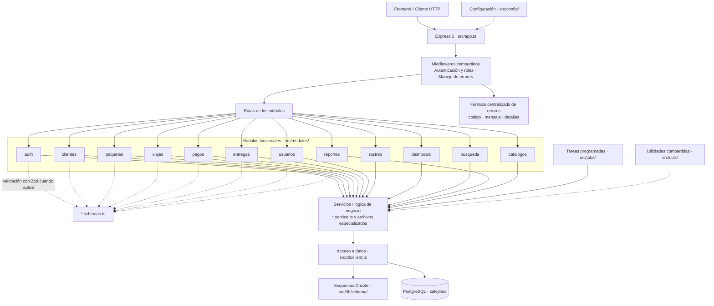

# Diagrama de módulos — SalvyControl Backend

Repositorio: https://github.com/adrnull06/SalvyControl_Backend

## Arquitectura general

## Responsabilidad de las capas

- **Rutas (`*.routes.ts`):** reciben las peticiones HTTP, aplican validaciones y delegan el trabajo a la lógica correspondiente.
- **Esquemas (`*.schemas.ts`):** definen las reglas de validación de los datos mediante Zod, en los módulos que los requieren.
- **Servicios y archivos especializados:** contienen la lógica de negocio y las operaciones de acceso a datos.
- **Middlewares:** gestionan autenticación/autorización y centralizan el tratamiento de errores.
- **Capa de datos:** Drizzle ORM conecta la API con PostgreSQL; los esquemas están organizados en `src/db/schema/`.
- **Tareas programadas:** `src/jobs/` ejecuta procesos automáticos, como la tarea relacionada con viajes.
- **Utilidades compartidas:** `src/utils/` contiene funciones reutilizables por distintos módulos.

> **Nota sobre la implementación:** el diagrama resume las responsabilidades arquitectónicas, no implica que todos los módulos tengan exactamente los mismos archivos. En el repositorio, por ejemplo, `catalogos` solo contiene rutas y `busqueda` no tiene un archivo `*.schemas.ts`; `reportes` además separa funciones de datos, exportación y resumen en archivos especializados.
